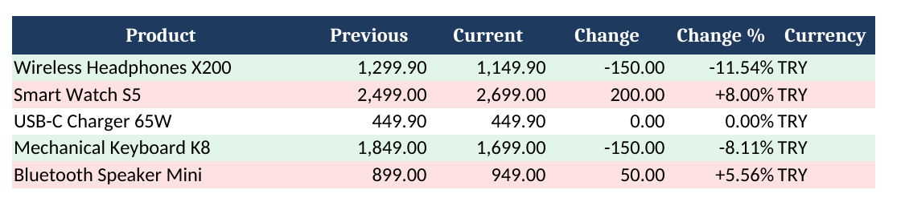

# Price Tracker Bot

Monitor product prices on any e-commerce site, keep a price history, get a colour-coded Excel report and a Telegram alert when a price changes.



*Green: price dropped. Red: price went up. A second sheet keeps the full history.*

> **Not a coder?** The free code below is everything you need. If you'd rather skip the setup, there is a
> [ready-to-run kit on Gumroad](https://mustafakosan.gumroad.com/l/price-tracker-bot) ($15, by the author of this repo)
> with one-click Windows scripts and an 8-page PDF setup guide. Buying it is optional and supports the project.

## Features

- **Works with most shops**: you give a URL and a CSS selector, the bot reads the price
- **Understands local price formats**: `£51.77`, `$1,299.90`, `1.299,90 TL`, `1 299,00 €`
- **Price history** in a single SQLite file, no database server
- **Excel report** with a summary sheet (change and change %) and a full history sheet
- **Telegram alerts** with a configurable threshold (e.g. only moves of 1% or more)
- **Polite scraping**: respects `robots.txt`, waits between requests, retries with back-off
- **Robust**: one broken page never stops the run; errors are reported, not hidden
- **Tested**: 40 automated tests, CI on Python 3.11 to 3.13
- **Few dependencies**: pure-Python packages only, installs cleanly on Windows, macOS and Linux

## Quick start

Requires Python 3.11 or newer.

```bash
git clone https://github.com/<your-username>/price-tracker.git
cd price-tracker
python -m venv .venv && source .venv/bin/activate   # Windows: .venv\Scripts\activate
pip install -r requirements.txt
```

**Windows shortcut:** double-click `windows_check.bat`. It sets everything up, runs the tests, the demo and a real check, and writes the results to `test_log.txt`.

### See it work in 10 seconds (no internet needed)

```bash
python examples/demo.py
```

This simulates two days of checks on a sample shop and writes `examples/output/reports/price_report.xlsx`.

### Track real products

```bash
cp config.example.toml config.toml    # Windows: copy config.example.toml config.toml
python -m tracker --config config.toml
```

`config.toml` in short:

```toml
[alerts]
min_change_percent = 1        # alert only on moves of 1% or more

[[products]]
name = "A Light in the Attic"
url = "https://books.toscrape.com/catalogue/a-light-in-the-attic_1000/index.html"
selector = ".product_main .price_color"
currency = "GBP"
```

Add one `[[products]]` block per product.

**Finding the selector:** right-click the price in Chrome → *Inspect* → right-click the highlighted element → *Copy → Copy selector*. Short, class-based selectors like `.product-price` survive site redesigns better than long auto-generated ones.

## Telegram alerts

1. In Telegram, message **@BotFather**, send `/newbot` and copy the token.
2. Send any message to your new bot, then open `https://api.telegram.org/bot<TOKEN>/getUpdates` and copy the `chat.id` number.
3. Copy `.env.example` to `.env` (next to `config.toml`) and fill in both values.

Without these values the bot still runs and prints alerts to the console.

Example alert:

```
📊 2 price change(s)
🔻 Wireless Headphones X200
    1,299.90 TRY → 1,149.90 TRY (-11.54%)
🔺 Smart Watch S5
    2,499.00 TRY → 2,699.00 TRY (+8.00%)
```

## Run it on a schedule

**Linux / macOS (cron)**, every day at 09:00:

```cron
0 9 * * * cd /path/to/price-tracker && .venv/bin/python -m tracker -c config.toml >> tracker.log 2>&1
```

**Windows**: Task Scheduler → *Create Basic Task* → program `C:\path\to\price-tracker\.venv\Scripts\python.exe`, arguments `-m tracker -c config.toml`, start in `C:\path\to\price-tracker`.

For 24/7 runs without your own computer, the same command works on any small cloud server.

## Command line

```
python -m tracker [-c CONFIG] [--no-notify] [-v]

  -c, --config   path to config file (default: config.toml)
  --no-notify    update history and report only, send no alerts
  -v, --verbose  debug logging
```

Exit codes: `0` success, `1` every product failed, `2` config problem. Handy for monitoring.

## Project layout

```
tracker/
  config.py     load and validate config.toml (+ .env secrets)
  scraper.py    polite fetching: robots.txt, delay, retries; CSS extraction
  prices.py     parse localised price text into Decimal
  storage.py    SQLite price history
  core.py       check loop and change detection
  report.py     Excel report (openpyxl)
  notifier.py   Telegram / console alerts
tests/          pytest suite, runs fully offline
examples/       offline demo
```

Run the tests:

```bash
pip install -r requirements-dev.txt
pytest
```

## Responsible use

Only collect publicly available data, follow each site's terms of service, and keep request rates low. The bot honours `robots.txt` by default. Sites that require a login or render prices with JavaScript are out of scope for this version.

## License

MIT
